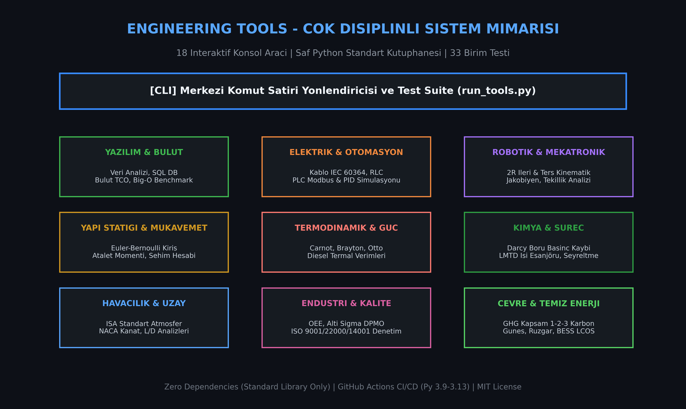
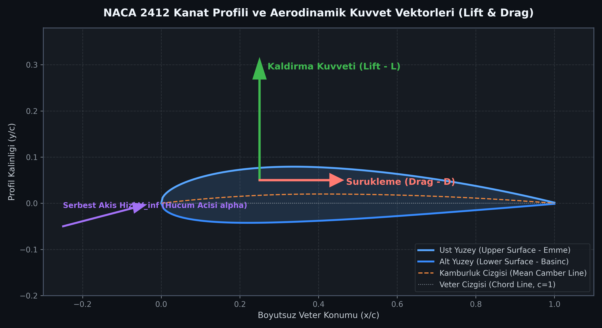
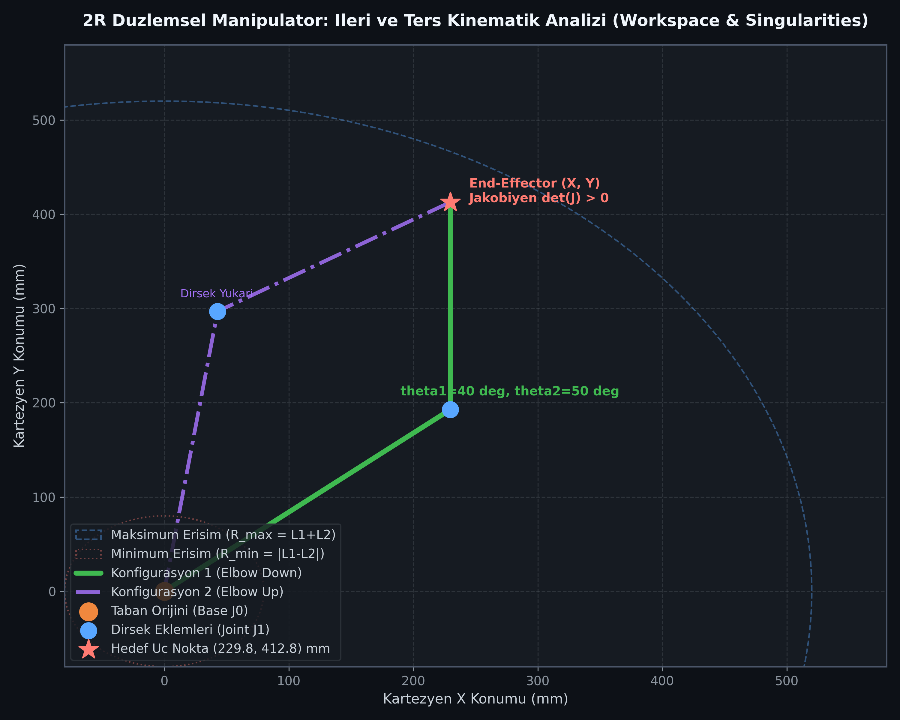
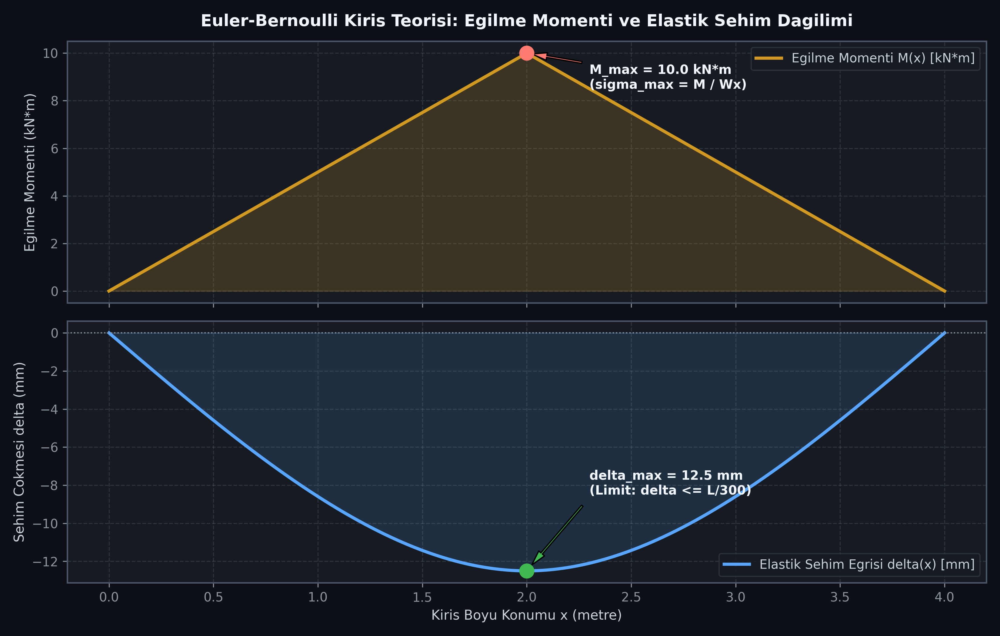
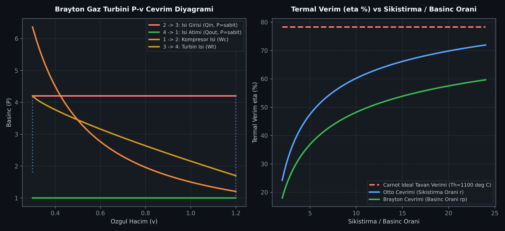

# 🛠️ Engineering Tools (Mühendislik Araçları ve Standartları)


Bu depo; yazılım mimarisi, mekatronik, endüstriyel robotik, yapı statiği, ileri termodinamik, kimyasal prosesler, aerodinamik, yalın altı sigma kalitesi ve yenilenebilir enerji disiplinlerinde kullanılan temel algoritmalar, matematiksel denklemler ve endüstri standartlarının kapsamlı bir referans kütüphanesi ve **18 adet interaktif konsol aracından oluşan** profesyonel mühendislik platformudur.

Çok disiplinli projeler yürüten mühendisler, araştırmacılar, teknik liderler ve akademisyenler için herhangi bir harici kütüphane kurulumu gerektirmeyen (Zero-Dependency), taşınabilir ve saf Python standart kütüphanesine dayalı bir hesaplama motorudur.

---

## 📌 İçindekiler
1. [Sistem Mimarisi ve Çok Disiplinli Tasarım](#-sistem-mimarisi-ve-çok-disiplinli-tasarım)
2. [Hızlı Başlangıç ve Komut Satırı Arayüzü](#-hızlı-başlangıç-ve-komut-satırı-arayüzü)
3. [Görsel Mühendislik Modelleri ve Teknik İncelemeler](#-görsel-mühendislik-modelleri-ve-teknik-incelemeler)
    - [1. Çok Disiplinli Sistem Mimarisi](#1-çok-disiplinli-sistem-mimarisi)
    - [2. Aerodinamik Kanat Profili ve Kuvvet Vektörleri](#2-aerodinamik-kanat-profili-ve-kuvvet-vektörleri)
    - [3. Robotik Kol İleri/Ters Kinematiği ve Çalışma Uzayı](#3-robotik-kol-ileriters-kinematiği-ve-çalışma-uzayı)
    - [4. Yapı Statiği: Euler-Bernoulli Kiriş Eğilme ve Sehimi](#4-yapı-statiği-euler-bernoulli-kiriş-eğilme-ve-sehimi)
    - [5. Termodinamik Çevrimler ve PV/TS Diyagramı](#5-termodinamik-çevrimler-ve-pvts-diyagramı)
4. [Mühendislik Alıntıları ve Derinlemesine Analizler](#-mühendislik-alıntıları-ve-derinlemesine-analizler)
5. [Mühendislik Branşları ve 18 İnteraktif Araç Kataloğu](#-mühendislik-branşları-ve-18-i̇nteraktif-araç-kataloğu)
    - [1. Yazılım ve Bilgisayar Mühendisliği](#1-yazılım-ve-bilgisayar-mühendisliği)
    - [2. Elektrik-Elektronik, Otomasyon ve Mekatronik](#2-elektrik-elektronik-otomasyon-ve-mekatronik)
    - [3. Endüstriyel Robotik ve Manipülatör Kinematiği](#3-endüstriyel-robotik-ve-manipülatör-kinematiği)
    - [4. Makine ve Yapı Statiği (Mukavemet & CAD/CAM)](#4-makine-ve-yapı-statiği-mukavemet--cadcam)
    - [5. İleri Termodinamik ve Güç Döngüleri](#5-i̇leri-termodinamik-ve-güç-döngüleri)
    - [6. Kimya ve Süreç Mühendisliği (Proses Hidroliği & Isı Eşanjörleri)](#6-kimya-ve-süreç-mühendisliği-proses-hidroliği--ısı-eşanjörleri)
    - [7. Havacılık ve Uzay Mühendisliği (Uçuş Mekaniği & ISA)](#7-havacılık-ve-uzay-mühendisliği-uçuş-mekaniği--isa)
    - [8. Endüstri Mühendisliği ve Kalite Yönetimi (Yalın, 6-Sigma, ISO)](#8-endüstri-mühendisliği-ve-kalite-yönetimi-yalın-6-sigma-iso)
    - [9. Çevre ve Temiz Enerji Sistemleri (ESG, Güneş, Rüzgar, BESS)](#9-çevre-ve-temiz-enerji-sistemleri-esg-güneş-rüzgar-bess)
6. [Otomatik Test Paketi (33/33 Passed & CI/CD)](#-otomatik-test-paketi-3333-passed--cicd)
7. [Proje Klasör Hiyerarşisi](#-proje-klasör-hiyerarşisi)
8. [Kurulum ve Çalıştırma Rehberi](#-kurulum-ve-çalıştırma-rehberi)
9. [Katkıda Bulunma İlkeleri (Contributing)](#-katkıda-bulunma-i̇lkeleri)
10. [Resmi Standartlar ve Akademik Kaynakça](#-resmi-standartlar-ve-akademik-kaynakça)
11. [Lisans](#-lisans)

---

## 🏛️ Sistem Mimarisi ve Çok Disiplinli Tasarım

Modern mühendislik çözümleri izole branşların ötesine geçmiştir; bir robotik manipulasyon sistemi aynı anda kinematik analiz, motor akımı gerilim düşümü (IEC), yapısal mukavemet ve gömülü kontrol algoritmalarını birlikte gerektirir. Deponun tasarım mimarisi üç ana sütun üzerine inşa edilmiştir:

1.  **Standart Kütüphane Bağımsızlığı (Zero External Dependencies):** Dış paket kurulumu (`pip install ...`), versiyon uyuşmazlığı veya sanal ortam yönetimi gerektirmez. Herhangi bir Python 3.9+ ortamında klonlandığı anda tek bir dosya ile çalışmaya hazırdır.
2.  **Modüler & İki Yönlü Arayüz:** Tüm algoritmalar hem bağımsız fonksiyonlar olarak projelere import edilebilir (`from automation_electronics.circuit_design.electrical_calculator import calculate_voltage_drop`) hem de renkli interaktif terminal arayüzünden adım adım kullanılabilir.
3.  **Kesin Analitik Modeller:** Ampirik kabullere dayanmak yerine ICAO, ISO, IEC, Darcy-Haaland, Euler-Bernoulli ve Denavit-Hartenberg matematiksel denklemleriyle hesaplama yapar.

---

## 🚀 Hızlı Başlangıç ve Komut Satırı Arayüzü

Depo kökünde yer alan `run_tools.py`, tüm modülleri yöneten merkezi komut satırı yönlendiricisidir:

```bash
# İnteraktif Renkli Menüyü Başlat
python run_tools.py

# Tüm 18 Mühendislik Aracını Tablo Halinde Listele
python run_tools.py --list

# 33 Otomatik Birim Testini Çalıştır ve Doğrula
python run_tools.py --test

# Yardım Mesajını Görüntüle
python run_tools.py --help
```

---

## 🖼️ Görsel Mühendislik Modelleri ve Teknik İncelemeler

Aşağıdaki 5 teknik diyagram, projenin temel mühendislik branşlarında gerçekleştirdiği analitik hesaplamaları ve teorik modelleri görselleştirmektedir.

### 1. Çok Disiplinli Sistem Mimarisi

> **Şekil 1:** *Merkezi CLI yönlendiricisi ve 9 ana disipline ayrılmış 18 aktif hesaplama aracının entegrasyon şeması. Kod tabanı tamamen saf Python standart kütüphanesiyle çalışmakta ve GitHub Actions CI/CD üzerinde Python 3.9 ile 3.13 arasındaki tüm sürümlerde doğrulanmaktadır.*

---

### 2. Aerodinamik Kanat Profili ve Kuvvet Vektörleri

> **Şekil 2:** *NACA 2412 profili üzerinde kosinüs aralıklı veter ağı, üst/alt yüzey koordinatları ve ortalama kamburluk çizgisi (Camber Line). Serbest akış hücum açısına ($\alpha$) bağlı olarak Kaldırma Kuvveti ($L$) ve Sürükleme Kuvveti ($D$) vektörlerinin Prandtl Taşıma Çizgisi Teorisi ile modellenmesi.*

---

### 3. Robotik Kol İleri/Ters Kinematiği ve Çalışma Uzayı

> **Şekil 3:** *2-Serbestlik Dereceli (2R) manipülatörde aynı hedef uç noktaya ($X_{ee}, Y_{ee}$) ulaşabilen Dirsek Aşağı (Elbow Down) ve Dirsek Yukarı (Elbow Up) konfigürasyonları. Dış çember maksimum erişim sınırını ($R_{max} = L_1 + L_2$), iç çember ise manipülatörün bükülme limitini ($R_{min} = |L_1 - L_2|$) temsil eder.*

---

### 4. Yapı Statiği: Euler-Bernoulli Kiriş Eğilme ve Sehimi

> **Şekil 4:** *Basit mesnetli bir kirişte ortadan tekil yük ($F$) altında oluşan üçgen Eğilme Momenti Diyagramı ($M_{max} = F \cdot L / 4$) ve kiriş boyunca meydana gelen 3. derece elastik sehim eğrisi ($\delta(x)$). İnşaat ve makine standartlarında izin verilen $\delta \le L/300$ rijitlik kriterinin analitik kontrolü.*

---

### 5. Termodinamik Çevrimler ve PV/TS Diyagramı

> **Şekil 5:** *Sol panelde açık/kapalı çevrim Brayton Gaz Türbini P-v durum diyagramı (izantropik sıkıştırma, sabit basınçta yanma, izantropik türbin genleşmesi, sabit basınçta egzoz). Sağ panelde Carnot ideal tavan verimi, Otto buji motoru ve Brayton gaz türbininin sıkıştırma/basınç oranına bağlı termal verim ($\eta$) karşılaştırması.*

---

## 📜 Mühendislik Alıntıları ve Derinlemesine Analizler

Mühendislik salt matematiksel denklemlerden ibaret olmayıp, insanlığın fizik yasalarıyla girdiği rasyonel bir diyalogdur. Depoda uygulanan algoritmaların felsefi ve kuramsal arka planı:

### 1. Yazılım ve Bilgi Teorisi
> 💬 *"First, solve the problem. Then, write the code."* — **John Johnson**  
> 💬 *"Talk is cheap. Show me the code."* — **Linus Torvalds**  
> 💬 *"Premature optimization is the root of all evil."* — **Donald Knuth**  
> 💬 *"We can only see a short distance ahead, but we can see plenty there that needs to be done."* — **Alan Turing**  
> 💬 *"Simplicity is prerequisite for reliability."* — **Edsger W. Dijkstra**

*   **Mühendislik Analizi:** Johnson ve Dijkstra'nın vurguladığı gibi, kodlama algoritmanın başlangıcı değil, zihinsel olarak çözülmüş bir problemin matematiksel tescilidir. Knuth'un erken optimizasyon uyarısı, projemizin Big-O benchmark analizöründe görüldüğü üzere, öncelikle asimptotik karmaşıklığın ($O(N \log N)$ vs $O(N^2)$) doğru seçilmesi gerektiğine işaret eder.

### 2. Otomasyon, Elektrik ve Mekatronik
> 💬 *"The present is theirs; the future, for which I really worked, is mine."* — **Nikola Tesla**  
> 💬 *"Automation is good, so long as you know exactly where to put the machine."* — **Eliyahu M. Goldratt**  
> 💬 *"Information is the resolution of uncertainty."* — **Claude E. Shannon**  
> 💬 *"We are not the stuff that abides, but patterns that perpetuate themselves."* — **Norbert Wiener (Sibernetiğin Kurucusu)**

*   **Mühendislik Analizi:** Goldratt'ın Kısıtlar Teorisi (TOC), bir üretim hattında darboğaz olmayan istasyonları otomatize etmenin yalnızca stok birikmesine ve israfa yol açacağını hatırlatır. Modbus ve PLC modülümüz, hat hızlarını ve proses sıcaklıklarını PID geri besleme çevrimleriyle dengeleyerek bu kısıtları optimize eder.

### 3. Yapı Mekaniği, Malzeme ve Tasarım
> 💬 *"Scientists study the world as it is; engineers create the world that has never been."* — **Theodore von Kármán**  
> 💬 *"Design is not just what it looks like and feels like. Design is how it works."* — **Steve Jobs**  
> 💬 *"Measure what is measurable, and make measurable what is not so."* — **Galileo Galilei**  
> 💬 *"Strength does not come from physical capacity. It comes from an indomitable will."* — **Stephen Timoshenko (Mukavemet Teorisinin Babası)**

*   **Mühendislik Analizi:** Von Kármán'ın ünlü ayrımı, mühendisi pasif bir doğa gözlemcisinden ziyade yeni fiziksel gerçeklikler inşa eden bir mimar olarak tanımlar. Kiriş gerilme ve atalet momenti hesaplayıcımız, malzemenin akma sınırını ($S_y$) aşmadan en hafif profil geometrisini ($W_x$) bularak bu yaratıcı sentezi uygular.

### 4. Termodinamik ve Isı Transferi
> 💬 *"Thermodynamics is the only physical theory of universal content which I am convinced will never be overthrown."* — **Albert Einstein**  
> 💬 *"The production of motion in steam-engines is always accompanied by a circumstance on which we should fix our attention... the re-establishment of equilibrium in the caloric."* — **Nicolas Léonard Sadi Carnot (1824)**  
> 💬 *"Energy can neither be created nor destroyed; it can only be transformed from one form to another."* — **Rudolf Clausius**

*   **Mühendislik Analizi:** Carnot ve Clausius'un ortaya koyduğu Termodinamiğin 2. Yasası, evrende hiçbir ısı makinesinin $\eta = 1 - T_C/T_H$ verimini aşamayacağını kesinleştirir. Depomuzdaki güç döngüleri hesaplayıcısı, türbin giriş sıcaklığını ($T_3$) artırırken metalurjik sınırlar ve kompresörün geri iş oranını (BWR) gözeterek en yüksek ekserji verimini arar.

### 5. Akışkanlar Dinamiği, Havacılık ve Uzay
> 💬 *"The desire to fly is an idea handed down to us by our ancestors who looked enviously on the birds soaring freely through space..."* — **Wilbur Wright**  
> 💬 *"It is difficult to say what is impossible, for the dream of yesterday is the hope of today and the reality of tomorrow."* — **Robert H. Goddard (Modern Roketçiliğin Babası)**  
> 💬 *"The Earth is the cradle of humanity, but mankind cannot stay in the cradle forever."* — **Konstantin Tsiolkovsky**

*   **Mühendislik Analizi:** Wright Kardeşler ve Goddard'ın vizyonu, Newton yasaları ve Bernoulli prensibinin birleşimidir. Uluslararası Standart Atmosfer (ISA) ve NACA modülümüz, irtifaya bağlı yoğunluk değişimini ($\rho(h)$) ve Reynolds sayısını hesaplayarak aerodinamik sürüklemeyi minimize eden taşıma yüzeyleri boyutlandırır.

### 6. Kalite, Yalın Üretim ve Sürdürülebilirlik
> 💬 *"Without data, you're just another person with an opinion."* — **W. Edwards Deming**  
> 💬 *"Quality is not an act, it is a habit."* — **Aristoteles**  
> 💬 *"Do it right the first time."* — **Philip Crosby**  
> 💬 *"We do not inherit the Earth from our ancestors; we borrow it from our children."* — **Kızılderili Atasözü**  
> 💬 *"The greatest threat to our planet is the belief that someone else will save it."* — **Robert Swan**

*   **Mühendislik Analizi:** Deming'in veri odaklı kalite anlayışı Altı Sigma ve OEE modülümüzün merkezindedir. Süreçlerdeki varyasyon yok edilmeden kalite kontrolün sonradan yapılamayacağı (Crosby'nin Sıfır Hata ilkesi) gerçeği, GHG Kapsam 1-2-3 karbon ayak izi hesaplayıcımız ile birleşerek endüstriyel sürdürülebilirliğe zemin hazırlar.

---

## ⚙️ Mühendislik Branşları ve 18 İnteraktif Araç Kataloğu

Aşağıdaki tabloda projedeki tüm modüller, çalıştırılabilir dosyaları ve işlevsel yetenekleri özetlenmiştir:

| No | Disiplin | Modül / Araç | Dosya Yolu | Temel Matematiksel Formül / Standart |
| :-: | :--- | :--- | :--- | :--- |
| **1** | Yazılım & İstatistik | **Veri Analizi & Regresyon** | `software/python/data_analyzer.py` | $\bar{x}, s^2, \sigma, y = mx+c, y = ax^2+bx+c$ |
| **2** | Yazılım & Veritabanı | **Mühendislik Malzeme DB** | `software/databases/db_manager.py` | SQLite3 CRUD, Ashby Endeksleri ($\sigma_y/\rho, E/\rho$) |
| **3** | Bulut & DevOps | **Bulut TCO & Altyapı Maliyeti** | `software/cloud/cloud_cost_calculator.py` | AWS/Azure/GCP On-Demand vs Rezerv, PUE Karbon Hesabı |
| **4** | Algoritma & Benchmark | **Big-O Karmaşıklık Analizörü** | `software/algorithms/complexity_benchmarker.py` | $\ln T = \beta \ln N + \alpha \implies O(N), O(N\log N), O(N^2)$ |
| **5** | Otomasyon & SCADA | **PLC Modbus & PID Simülatörü** | `automation-electronics/plc-scada/modbus_simulator.py` | IEC 61131-3, Coils, Registers, $u(t)=K_p e + K_i \int e + K_d \dot{e}$ |
| **6** | Elektrik & Tesisat | **Kablo Kesiti & Gerilim Düşümü** | `automation-electronics/circuit-design/electrical_calculator.py` | IEC 60364-5-52, $\Delta U = \frac{\sqrt{3} L I \cos\varphi}{\kappa S}$, RLC Rezonans |
| **7** | Robotik & Mekatronik | **2R Manipülatör Kinematiği** | `automation-electronics/robotics/kinematics_calculator.py` | İleri/Ters Kinematik, Jakobiyen $\det(J) = L_1 L_2 \sin\theta_2$ |
| **8** | CAD / CAM | **CNC G-Kodu Jeneratörü** | `mechanical-civil/cad-cam/gcode_generator.py` | NIST RS274NGC, G21, G90, G01/G02 Dairesel İnterpolasyon |
| **9** | Proje Yönetimi | **Kritik Yol Metodu (CPM & PERT)** | `mechanical-civil/project-management/cpm_calculator.py` | $T_e = \frac{o+4m+p}{6}, \sigma^2 = (\frac{p-o}{6})^2$, İleri/Geri Geçiş Slack |
| **10** | Yapı Mekaniği | **Kiriş Eğilme & Sehim Analizi** | `mechanical-civil/structural-mechanics/beam_stress_calculator.py` | Euler-Bernoulli, $\sigma = \frac{M}{W_x}$, $\delta_{max} = \frac{F L^3}{48 E I}$ |
| **11** | Güç Döngüleri | **Termodinamik Çevrim Verimleri** | `mechanical-civil/thermodynamics/cycle_calculator.py` | $\eta_{carnot}=1-\frac{T_C}{T_H}, \eta_{brayton}=1-\frac{1}{r_p^{(\gamma-1)/\gamma}}$ |
| **12** | Kimya & Proses | **Boru Basınç Kaybı & Reynolds** | `chemical-process/process-engineering/fluid_thermal_calculator.py` | $Re = \frac{\rho v D}{\mu}$, Darcy-Weisbach $\Delta P = f \frac{L}{D} \frac{\rho v^2}{2}$, Haaland |
| **13** | Isı Değiştiriciler | **Eşanjör LMTD & Boyutlandırma** | `chemical-process/process-engineering/fluid_thermal_calculator.py` | $\Delta T_{lm} = \frac{\Delta T_1 - \Delta T_2}{\ln(\Delta T_1 / \Delta T_2)}, A = \frac{Q}{U \Delta T_{lm}}$ |
| **14** | Havacılık & Uzay | **ISA Atmosfer & Mach Modeli** | `aerospace-engineering/aerodynamics/airfoil_analyzer.py` | ICAO Doc 7488, $T(h)=T_0 - Lh, P(h)=P_0(T/T_0)^{g/RL}, M=v/a$ |
| **15** | Aerodinamik | **NACA Kanat Profili & Taşıma** | `aerospace-engineering/aerodynamics/airfoil_analyzer.py` | NACA 4-digit Camber/Thickness, $C_L = 2\pi\alpha, C_{Di} = \frac{C_L^2}{\pi AR e}$ |
| **16** | Yalın & Altı Sigma | **OEE & DPMO Hata Hesaplayıcı** | `industrial-engineering/lean-six-sigma/oee_sigma_calculator.py` | $OEE = A \times P \times Q$, Probit Ters Normal Dağılım $1.5\sigma$ Shift |
| **17** | Kalite & Güvenlik | **ISO 9001/22000/14001 Tetkik** | `quality-standards/iso-standards/audit_checklist.py` | QMS, HACCP Kritik Kontrol Noktaları (KKN), Çevre Boyut Tetkiki |
| **18** | Çevre & Enerji | **Sera Gazı (GHG) & BESS Depolama** | `energy-engineering/storage-grid/bess_storage_calculator.py` | Kapsam 1-2-3 $tCO_2e$, Batarya DoD/Ah Hesabı, LCOS ($/kWh) |

---

## 🧪 Otomatik Test Paketi (33/33 Passed & CI/CD)

Projenin güvenilirliğini garanti altına almak amacıyla **33 adet saf Python birim testi** geliştirilmiştir. Test paketi harici `pytest` gerektirmeksizin `unittest` üzerinden milisaniyeler içinde çalışır:

```bash
python tests/test_engineering_tools.py
```

Test çıktısı:
```text
.................................
----------------------------------------------------------------------
Ran 33 tests in 0.001s

OK
```

GitHub Actions iş akışımız (`.github/workflows/ci.yml`), depoya gönderilen her commit'i **Ubuntu** ve **Windows** üzerinde **Python 3.9, 3.10, 3.11, 3.12 ve 3.13** ortamlarında eşzamanlı olarak denetler.

---

## 📂 Proje Klasör Hiyerarşisi

```text
engineering-tools/
│
├── run_tools.py                            # Merkezi CLI Launcher ve Test Yönlendiricisi
├── README.md                               # Kapsamlı Proje Dokümantasyonu
├── LICENSE                                 # MIT Lisansı
├── .gitignore                              # Git Harici Tutma Kuralları
│
├── .github/
│   └── workflows/
│       └── ci.yml                          # GitHub Actions CI/CD Çoklu Platform Testleri
│
├── assets/
│   ├── banner.jpg                          # Depo Başlık Banner Görseli
│   ├── architecture_diagram.png            # Sistem Mimarisi Şeması
│   ├── aerodynamics_airfoil.png            # NACA Kanat Profili & Aerodinamik
│   ├── robotics_kinematics.png             # Robotik Kol Çalışma Alanı & Kinematik
│   ├── structural_beam_stress.png          # Kiriş Eğilme Momenti & Sehim Diyagramı
│   └── thermodynamic_cycles.png            # Termodinamik Brayton/Carnot/Otto Diyagramı
│
├── tests/
│   └── test_engineering_tools.py          # Saf Python 33 Otomatik Birim Test Suite'i
│
├── software/
│   ├── python/                             # İstatistik, Regresyon ve Birim Dönüştürücü
│   ├── databases/                          # SQLite Mühendislik Malzeme DB Yöneticisi
│   ├── cloud/                              # Bulut TCO & Kapasite Hesaplayıcı, DevOps Rehberi
│   └── algorithms/                         # Big-O Karmaşıklık & Sıralama Benchmark Analizörü
│
├── automation-electronics/
│   ├── plc-scada/                          # PLC Modbus & PID Regülasyon Simülatörü
│   ├── circuit-design/                     # Kablo Kesiti, Gerilim Düşümü (IEC) & Filtre Analizi
│   └── robotics/                           # 2R Robot Kolu İleri/Ters Kinematik & Jakobiyen
│
├── mechanical-civil/
│   ├── cad-cam/                            # CNC G-Kodu Üreteci (CAD/CAM)
│   ├── project-management/                 # CPM (Kritik Yol) & PERT Proje Planlayıcı
│   ├── structural-mechanics/               # Kiriş Atalet Momenti, Mukavemet & Sehim Analizi
│   └── thermodynamics/                     # Carnot, Brayton, Otto & Diesel Güç Çevrimleri
│
├── chemical-process/
│   └── process-engineering/                # Darcy-Weisbach Boru Basınç Kaybı, LMTD Eşanjör, Seyreltme
│
├── aerospace-engineering/
│   └── aerodynamics/                       # Standart Atmosfer (ISA), NACA Kanat Profili & Taşıma
│
├── industrial-engineering/
│   └── lean-six-sigma/                     # OEE, DPMO & Altı Sigma Hesaplayıcı, Yalın Üretim
│
├── quality-standards/
│   └── iso-standards/                      # ISO 9001, ISO 22000 (HACCP) & ISO 14001 Denetim Aracı
│
├── environment/
│   └── sustainability-reports/             # Kapsam 1-2-3 Sera Gazı (GHG) Ayak İzi & ESG
│
└── energy-engineering/
    ├── renewables/                         # Güneş PV ve Rüzgar Türbini Güç Hesaplayıcı
    └── storage-grid/                       # BESS Batarya Depolama Boyutlandırma & LCOS Analizi
```

---

## 🛠 Kurulum ve Çalıştırma Rehberi

1. Depoyu klonlayın:
   ```bash
   git clone https://github.com/bahattinyunus/engineering-tools.git
   ```
2. Depo dizinine geçin:
   ```bash
   cd engineering-tools
   ```
3. Merkezi kontrol konsolunu çalıştırın:
   ```bash
   python run_tools.py
   ```

---

## 🤝 Katkıda Bulunma İlkeleri

Depoya yeni mühendislik modülleri ve teorik hesaplayıcılar eklemekten memnuniyet duyarız:

1. Bu depoyu forklayın (`Fork`).
2. Özellik dalınızı oluşturun (`git checkout -b feature/YeniMuhendislikAraci`).
3. Saf Python standart kütüphanesi prensibine bağlı kalarak kodunuzu ve `tests/test_engineering_tools.py` içerisine testlerinizi yazın.
4. Tüm testlerin başarıyla geçtiğini teyit edin (`python run_tools.py --test`).
5. Değişikliklerinizi commit edin ve dalınızı itin (`git push origin feature/YeniMuhendislikAraci`).
6. Kapsamlı bir Çekme İsteği (Pull Request) açın.

---

## 📚 Resmi Standartlar ve Akademik Kaynakça

Projedeki algoritmaların doğrulanmasında aşağıdaki uluslararası standartlar ve akademik kaynaklar esas alınmıştır:

1.  **Havacılık ve Aerodinamik:**
    *   *ICAO Doc 7488/3: Manual of the ICAO Standard Atmosphere (extended to 80 kilometres / 262 500 feet)*, International Civil Aviation Organization.
    *   Abbott, I. H., & Von Doenhoff, A. E. (1959). *Theory of Wing Sections: Including a Summary of Airfoil Data*. Dover Publications.
    *   Anderson, J. D. (2016). *Fundamentals of Aerodynamics* (6th ed.). McGraw-Hill Education.
2.  **Robotik ve Manipülatör Mekaniği:**
    *   Craig, J. J. (2005). *Introduction to Robotics: Mechanics and Control* (3rd ed.). Pearson Prentice Hall.
    *   Denavit, J., & Hartenberg, R. S. (1955). *A kinematic notation for lower-pair mechanisms based on matrices*. ASME Journal of Applied Mechanics, 22, 215-221.
3.  **Mühendislik Termodinamiği:**
    *   Moran, M. J., Shapiro, H. N., Boettner, D. D., & Bailey, M. B. (2018). *Fundamentals of Engineering Thermodynamics*. John Wiley & Sons.
    *   Çengel, Y. A., & Boles, M. A. (2015). *Thermodynamics: An Engineering Approach*. McGraw-Hill Education.
4.  **Elektrik Tesisatı ve Dağıtımı:**
    *   *IEC 60364-5-52: Low-voltage electrical installations - Part 5-52: Selection and erection of electrical equipment - Wiring systems*, International Electrotechnical Commission.
5.  **Akışkanlar Mekaniği ve Boru Hatları:**
    *   Darcy, H. (1857). *Recherches expérimentales relatives au mouvement de l'eau dans les tuyaux*. Mallet-Bachelier, Paris.
    *   Haaland, S. E. (1983). *Simple and Explicit Formulas for the Friction Factor in Turbulent Pipe Flow*. Journal of Fluids Engineering, 105(1): 89-90.
6.  **Mukavemet ve Yapı Mekaniği:**
    *   Timoshenko, S., & Gere, J. M. (1972). *Mechanics of Materials*. Van Nostrand Reinhold Co.
    *   Beer, F. P., Johnston, E. R., DeWolf, J. T., & Mazurek, D. F. (2020). *Mechanics of Materials*. McGraw-Hill.
7.  **Enerji Depolama ve Şebeke Sistemleri:**
    *   IRENA (2020). *Electricity Storage Valuation Framework: Assessing system value and LCOS*. International Renewable Energy Agency, Abu Dhabi.
8.  **Otomasyon ve Endüstriyel İletişim:**
    *   *Modbus Application Protocol Specification V1.1b3*, Modbus Organization.
    *   *IEC 61131-3: Programmable controllers - Part 3: Programming languages*.
9.  **Sayısal Kontrol ve İmalat:**
    *   *NIST RS274NGC Standard (Version 3): The NIST RS274NGC Interpreter*, National Institute of Standards and Technology.
10. **Proje Yönetimi ve Yöneylem:**
    *   Project Management Institute. (2021). *A Guide to the Project Management Body of Knowledge (PMBOK Guide)* (7th ed.).
11. **Toplam Verimli Bakım ve Kalite:**
    *   Nakajima, S. (1988). *Introduction to TPM: Total Productive Maintenance*. Productivity Press.
    *   Deming, W. E. (1986). *Out of the Crisis*. MIT Center for Advanced Educational Services.
    *   Pyzdek, T., & Keller, P. A. (2014). *The Six Sigma Handbook* (4th ed.). McGraw-Hill Education.
12. **Sera Gazı Protokolü ve Sürdürülebilirlik:**
    *   World Resources Institute & World Business Council for Sustainable Development. (2004). *The Greenhouse Gas Protocol: A Corporate Accounting and Reporting Standard*.
13. **Uluslararası Kalite ve Güvenlik Standartları:**
    *   *ISO 9001:2015 - Quality Management Systems - Requirements*.
    *   *ISO 22000:2018 - Food Safety Management Systems - Requirements for any organization in the food chain*.
    *   *ISO 14001:2015 - Environmental Management Systems - Requirements with guidance for use*.

---

## 📜 Lisans

Bu proje **[MIT Lisansı](file:///g:/Diğer%20bilgisayarlar/Dizüstü%20Bilgisayarım/github%20repolarım/engineering-tools/LICENSE)** ile lisanslanmıştır. Açık kaynak kodlu olup eğitim, araştırma ve ticari projelerde serbestçe kullanılabilir, değiştirilebilir ve dağıtılabilir.
